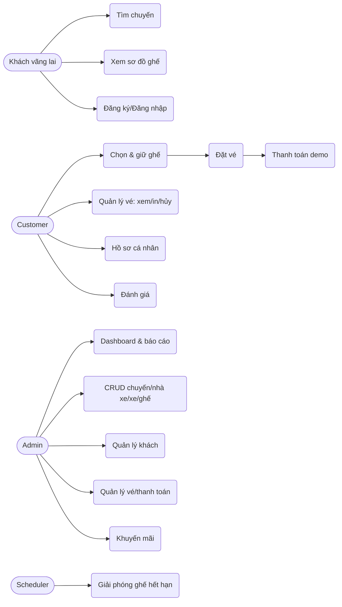
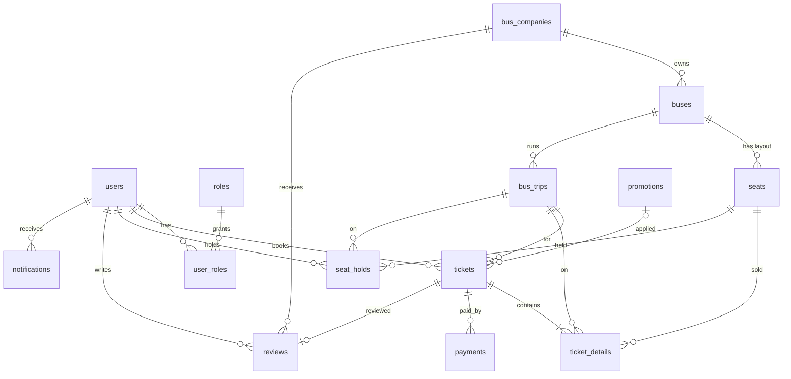

# GIAI ĐOẠN 1 – Phân tích hệ thống, Use Case, ERD

File: `docs/phase1-analysis.md` · SQL: `database/bus_ticket_booking.sql`

## 1. Actor & Use Case

| Actor | Use case |
|---|---|
| Khách vãng lai | Xem trang chủ, tìm/lọc chuyến, xem sơ đồ ghế, đăng ký, đăng nhập, quên mật khẩu |
| CUSTOMER | Giữ/chọn ghế, đặt vé, thanh toán (demo), xem/tra cứu/in/hủy vé, đánh giá, quản lý hồ sơ, đổi mật khẩu, xem lịch sử giao dịch |
| ADMIN | Dashboard, CRUD chuyến/nhà xe/xe/ghế/khuyến mãi, quản lý khách (khóa/mở, phân hạng), quản lý vé (xác nhận thanh toán, hủy), báo cáo + xuất Excel |
| Hệ thống (Scheduler) | Giải phóng ghế giữ quá 10 phút, hủy vé PENDING hết hạn, cập nhật trạng thái chuyến, nâng hạng thành viên |



## 2. Luồng nghiệp vụ đặt vé

```mermaid
sequenceDiagram
  participant U as Customer
  participant B as BookingService (@Transactional)
  participant DB as MySQL
  U->>B: Chọn ghế (A01, A02)
  B->>DB: INSERT seat_holds (HELD, expires=now+10') 
  DB-->>B: OK / Duplicate => "ghế đã có người giữ"
  U->>B: Xác nhận đặt vé
  B->>DB: INSERT tickets(PENDING) + ticket_details(ACTIVE)
  U->>B: Thanh toán (CASH/BANK/E_WALLET - DEMO)
  B->>DB: INSERT payments(SUCCESS) ; tickets=PAID ; holds=CONFIRMED
  Note over B,DB: Scheduler mỗi 1 phút: holds HELD quá hạn => EXPIRED, ticket PENDING => EXPIRED
```

## 3. Quy tắc nghiệp vụ (BR) & cách đảm bảo

| # | Quy tắc | Đảm bảo bởi |
|---|---|---|
| 1-2 | Chuyến/ghế phải tồn tại; ghế thuộc xe của chuyến | Service + FK |
| 3 | Không đặt ghế đã bán/đang giữ | `UNIQUE(trip_id, seat_id, active_key)` trên `ticket_details` & `seat_holds` + `@Transactional` + bắt `DataIntegrityViolationException` (ngoài ra có thể dùng `PESSIMISTIC_WRITE` trên `bus_trips`) |
| 4 | Giá > 0 | `CHECK (base_price > 0)` + `@Positive` |
| 5 | VIP có phụ phí | `bus_trips.vip_surcharge`, snapshot vào `ticket_details.surcharge` |
| 6 | Giảm giá hạng thành viên: **REGULAR 0%, MEMBER 5%, VIP 10%** (tính trên giá vé + phụ phí) | `PricingStrategy` (Strategy pattern – đa hình) |
| 7-8 | Không thanh toán vé không tồn tại / thanh toán 2 lần | `UNIQUE(ticket_id, success_key)` + kiểm tra trạng thái |
| 9 | Không đặt chuyến đã khởi hành | Service kiểm tra `departure_time > now` và status = SCHEDULED |
| 10 | Chặn truy cập admin | Spring Security `hasRole('ADMIN')` |
| 11 | Giải phóng ghế hết hạn | `@Scheduled` + `idx_hold_expiry` |
| 12 | Giao dịch nguyên tử | `@Transactional` |
| – | Hủy vé: hoàn 100% nếu ≥ 24h trước giờ đi, 70% nếu 6–24h, không cho hủy < 6h | `CancellationPolicy` (interface) |
| – | Hạng thành viên: tổng chi ≥ 2 triệu → MEMBER, ≥ 10 triệu → VIP | `users.total_spent` |

Cách chống trùng ghế: khi hủy vé, `ticket_details.status = CANCELLED` ⇒ `active_key = NULL` ⇒ MySQL cho phép ghi tiếp (UNIQUE bỏ qua NULL), nên ghế được giải phóng mà vẫn giữ lịch sử.
Ghế trống của một chuyến = ghế của xe **không** có `ticket_details ACTIVE` và **không** có `seat_holds HELD` còn hạn của người khác.

## 4. ERD



Quan hệ: **1-1** `tickets–reviews`; **1-n** công ty→xe→ghế/chuyến, vé→chi tiết/thanh toán; **n-n** `users–roles` qua `user_roles`.

## 5. Từ điển dữ liệu (rút gọn)

| Bảng | Khóa/Ràng buộc chính | Index |
|---|---|---|
| users | UQ username, email, phone | full_name, membership_type |
| roles | UQ name | – |
| bus_companies | UQ name; rating 0–5 | – |
| buses | UQ license_plate; FK company | company_id, bus_type |
| seats | UQ (bus_id, seat_code) | – |
| bus_trips | UQ trip_code; CHECK price>0, arrival>departure, origin≠destination | (origin, destination, departure_time), status |
| seat_holds | UQ (trip_id, seat_id, active_key) | (status, expires_at) |
| tickets | UQ ticket_code; FK user/trip/promotion | user, trip, status, created_at |
| ticket_details | UQ (trip_id, seat_id, active_key) | ticket_id |
| payments | UQ transaction_code, UQ (ticket_id, success_key) | status, paid_at |
| promotions | UQ code | – |
| reviews | UQ ticket_id; rating 1–5 | company_id |
| notifications | FK user | (user_id, is_read) |

## 6. Dữ liệu mẫu

- Mật khẩu **tất cả** tài khoản: `password` (BCrypt).
- Đăng nhập bằng email hoặc username (mật khẩu `password`): Admin `admin` / `admin@busgo.vn` · Customer REGULAR `customer` · MEMBER `binhtran` · VIP `cuongle`.
- 5 nhà xe, 6 xe (204 ghế, 4 ghế đầu mỗi tầng là VIP), 10 chuyến (có Hà Nội – Hải Phòng), 6 vé, thanh toán, đánh giá, khuyến mãi `WELCOME10`, `SUMMER50K`.
- Ngày khởi hành tính theo `CURDATE()` nên luôn có chuyến tương lai để thử.

## 7. Chạy SQL

MySQL Workbench → File ▸ Open SQL Script → `database/bus_ticket_booking.sql` → Execute (⚡). Script **DROP và tạo lại** DB `bus_ticket_booking`.

## 8. Quy ước cho các giai đoạn sau (cố định, không đổi)

- Package gốc: `com.example.booking`; DB: `bus_ticket_booking`; roles: `ROLE_ADMIN`, `ROLE_CUSTOMER`.
- Entity: `User, Role, BusCompany, Bus, BusTrip, Seat, SeatHold, Ticket, TicketDetail, Payment, Promotion, Review, Notification` (+ abstract `BaseEntity` có `createdAt/updatedAt`).
- Enum: `MembershipType, TripStatus, SeatType, TicketStatus, PaymentMethod, PaymentStatus, HoldStatus`.
- Hibernate `ddl-auto=none` (schema do file SQL quản lý; `validate` hay báo sai lệch với kiểu ENUM của MySQL). Cột `active_key`/`success_key` là generated – map `insertable=false, updatable=false`.
